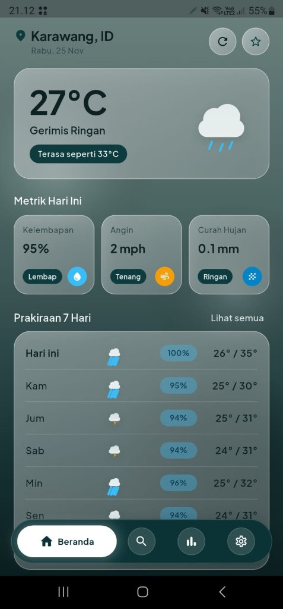
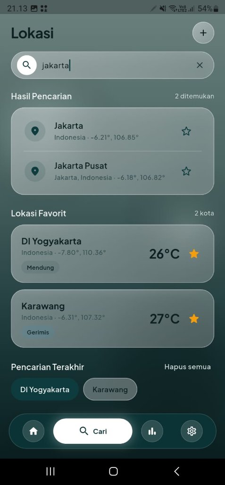
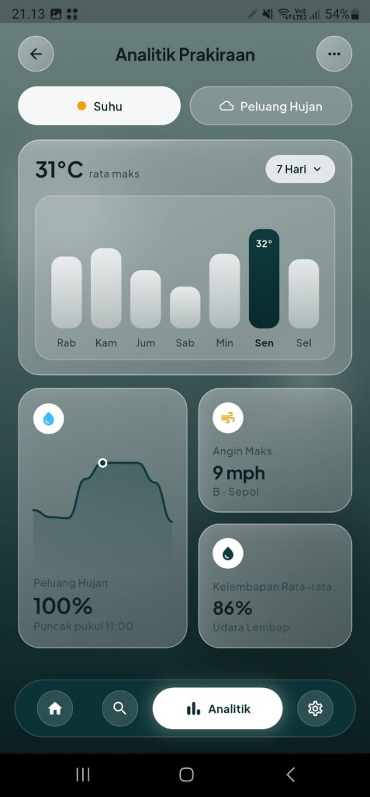
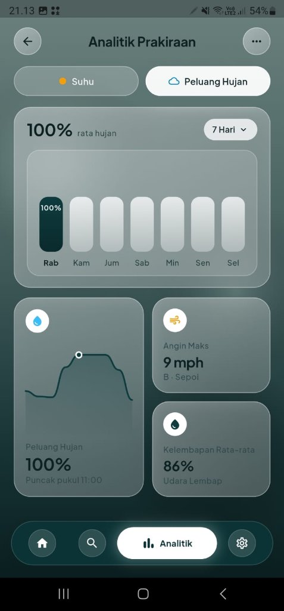
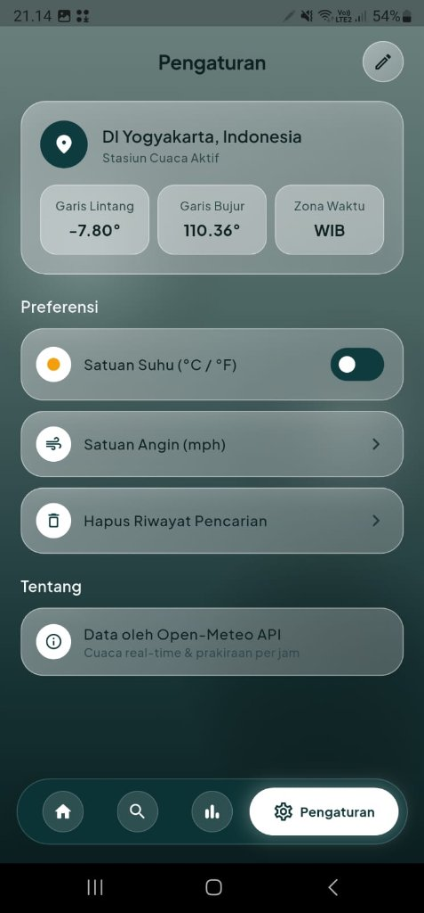

# AetherCast — Aplikasi Prakiraan Cuaca Flutter

> **Responsi 2 Praktikum Pemrograman Mobile** (`H1D024129`)

Aplikasi prakiraan cuaca real-time berbahasa Indonesia berbasis **Flutter (Dart)** dengan gaya antarmuka **Frosted Glassmorphism** (palet *misty sage* hingga *deep forest teal*), **Fluid Floating Bottom Navbar**, animasi tekan tombol interaktif (`SmoothTap`), arsitektur **MVVM (Model–View–ViewModel)**, state management **Provider**, penyimpanan lokal **SharedPreferences**, dan integrasi langsung **Open-Meteo REST API**.

---

## Fitur Utama

1. **Beranda / Cuaca (Wajib)**
   - Menampilkan nama kota aktif, tanggal hari ini berbahasa Indonesia, tombol muat ulang cepat, serta tombol status favorit (`★`).
   - **Hero Weather Card**: suhu terkini (`current.temperature_2m`), kondisi cuaca & ilustrasi dinamis (`current.weather_code`), dan badge *Terasa seperti* (`current.apparent_temperature`).
   - **Metrik Hari Ini**: kelembapan (`current.relative_humidity_2m`), kecepatan angin (`current.wind_speed_10m`), dan curah hujan (`current.precipitation`) lengkap dengan badge status.
   - **Prakiraan 7 Hari**: prakiraan harian 7 hari ke depan (`daily.weather_code`, `daily.precipitation_probability_max`, `daily.temperature_2m_min`, `daily.temperature_2m_max`).
   - Mendukung *pull-to-refresh*, indikator *loading*, tampilan *empty*, dan tampilan *error* dengan tombol **Coba Lagi**.

2. **Cari & Lokasi (Wajib)**
   - Pencarian kota real-time ke **Open-Meteo Geocoding API** (`language=id`) dengan *debounce* 400ms.
   - Daftar hasil pencarian menampilkan nama kota, wilayah/negara, koordinat lintang-bujur, dan tombol simpan favorit.
   - **Lokasi Favorit**: daftar lokasi favorit tersimpan permanen di `SharedPreferences`, lengkap dengan suhu & kondisi cuaca terkini langsung dari API.
   - **Pencarian Terakhir**: chip riwayat kota yang pernah dipilih dan dapat diklik ulang atau dihapus.

3. **Analitik Prakiraan (Tambahan)**
   - Filter **Suhu** vs **Peluang Hujan** dan pilihan durasi (**7 Hari**, **5 Hari**, **3 Hari**).
   - Grafik batang vertikal interaktif harian dengan bar aktif/puncak disorot warna *Deep Forest Teal*.
   - **Peluang Hujan** (kurva spline peluang hujan per jam + waktu puncak), **Angin Maks** (arah kompas dominan + status), dan **Kelembapan Rata-rata**.

4. **Pengaturan & Preferensi (Tambahan)**
   - Ringkasan stasiun cuaca aktif (*Garis Lintang*, *Garis Bujur*, *Zona Waktu*).
   - Pengaturan satuan suhu (`°C / °F`) dan satuan angin (`km/j / mph`) yang tersimpan di `SharedPreferences`.
   - Opsi hapus riwayat pencarian dan dialog informasi sumber data Open-Meteo.

---

## Struktur Aplikasi (MVVM)

```text
lib/
├── main.dart                                 # Entry point & MultiProvider setup
├── core/
│   ├── constants/api_constants.dart          # Endpoint Open-Meteo & StorageKeys
│   ├── theme/app_theme.dart                  # Tema Material 3, palet warna, dekorasi glass
│   └── utils/
│       ├── weather_code_mapper.dart          # Pemetaan WMO weather_code & status metrik (ID)
│       └── weather_formatter.dart            # Konversi °C/°F, km/j/mph, format tanggal (ID)
├── models/
│   ├── location_model.dart                   # Model Geocoding API & penyimpanan lokal
│   └── weather_model.dart                    # Model Current, Hourly, Daily Weather API
├── services/
│   ├── weather_api_service.dart              # HTTP GET ke Open-Meteo Weather & Geocoding API
│   └── local_storage_service.dart            # CRUD SharedPreferences (favorit, riwayat, unit)
├── viewmodels/
│   ├── weather_viewmodel.dart                # State cuaca aktif, loading/empty/error, unit
│   └── location_viewmodel.dart               # State pencarian kota, favorit, riwayat
└── views/
    ├── main_navigation_screen.dart           # Shell navigasi & fluid pill bottom bar
    ├── home/home_weather_screen.dart         # Screen 1: Beranda / Cuaca
    ├── search/search_location_screen.dart    # Screen 2: Cari & Lokasi Favorit
    ├── analytics/forecast_analytics_screen.dart # Screen 3: Analitik Prakiraan
    ├── settings/settings_screen.dart         # Screen 4: Pengaturan & Preferensi
    └── widgets/
        ├── atmospheric_background.dart       # Latar gradasi sage-teal
        ├── glass_card.dart                   # Komponen GlassCard & GlassIconButton
        ├── smooth_tap.dart                   # Efek tekan tombol membal & haptic ringan
        ├── weather_illustration.dart         # Ilustrasi vektor kondisi cuaca
        ├── analytics_charts.dart             # Grafik batang & spline area custom painter
        └── state_feedback_widgets.dart       # Widget Loading, Empty, dan Error Coba Lagi
```

---

## Penerapan Arsitektur MVVM

- **Model** (`models/`): Kelas data murni Dart (`LocationModel`, `WeatherModel`, `CurrentWeather`, `DailyForecast`, `HourlyForecastPoint`) dengan `fromJson` dan `toJson` tanpa dependensi widget Flutter.
- **Service** (`services/`): Layer akses data eksternal:
  - `WeatherApiService` melakukan HTTP `GET` menggunakan package `http` langsung ke Open-Meteo dan menangani error jaringan/timeout/status HTTP.
  - `LocalStorageService` mengelola persistensi data ke `SharedPreferences`.
- **ViewModel** (`viewmodels/`): `WeatherViewModel` dan `LocationViewModel` mewarisi `ChangeNotifier` (`provider`) untuk mengelola state UI (`loading`, `loaded`, `empty`, `error`), mengoordinasikan service, lalu memanggil `notifyListeners()`.
- **View** (`views/`): `StatelessWidget` dan `StatefulWidget` hanya membaca state via `Consumer2` / `context.read` dan meneruskan aksi pengguna kembali ke ViewModel.

---

## Implementasi Open-Meteo REST API

Aplikasi menggunakan metode **HTTP GET** ke dua endpoint resmi Open-Meteo (tanpa data cuaca statis/hardcoded):

1. **Geocoding API**
   ```text
   GET https://geocoding-api.open-meteo.com/v1/search?name={query}&count=10&language=id&format=json
   ```
2. **Weather Forecast API**
   ```text
   GET https://api.open-meteo.com/v1/forecast?latitude={lat}&longitude={lon}&current=temperature_2m,relative_humidity_2m,apparent_temperature,precipitation,weather_code,wind_speed_10m,is_day&hourly=relative_humidity_2m,precipitation_probability&daily=weather_code,temperature_2m_max,temperature_2m_min,precipitation_probability_max,wind_speed_10m_max,wind_direction_10m_dominant&timezone=auto&forecast_days=7
   ```

---

## Cara Menjalankan Proyek

```bash
flutter pub get
flutter test
flutter run
```

---

## Screenshot Aplikasi (Perangkat Android)

| Beranda / Cuaca | Cari & Lokasi | Analitik (Suhu) | Analitik (Peluang Hujan) | Pengaturan |
| :---: | :---: | :---: | :---: | :---: |
|  |  |  |  |  |
